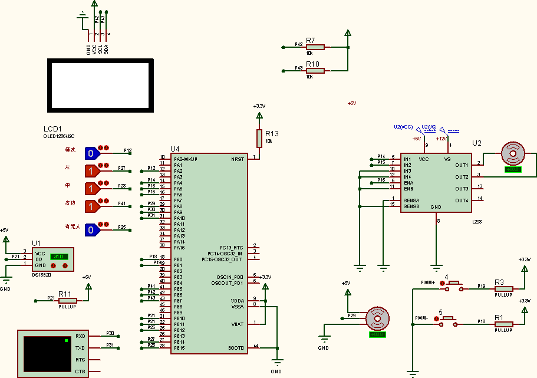

# STM32 智能风扇

基于 STM32F103C8 的智能风扇仿真，集成温度采样、OLED、PWM 调速按键和串口虚拟终端。

## 主要器件与接线
主控为 STM32F103C8，外接 DS18B20 温度传感器、I²C OLED、L298 电机驱动、直流电机、PWM 舵机和串口虚拟终端。PB0 / PB1 对应 PWM− / PWM+ 两路按键。

## 功能说明
电路提供温度和逻辑输入，可用 PWM± 按键观察电机输出变化，并从 OLED 和串口终端观察固件输出。

## 打开与使用
用 Proteus 8.17 打开「工程/SmartFan-Clean.pdsprj」。双击 U4，将 Program File 指向同目录的 smart_fan_usart3_keys_pb01.hex，然后启动仿真。原工程保存了本机绝对路径，下载后须重新选择 HEX。

## 编译与验证范围
随包提供 Proteus 工程和预编译 HEX。已在 Proteus 8.17 打开工程并导出原理图，未动态复测。工程包未附源码。

## 项目来源
用户提供的 SmartFan 工程包。
