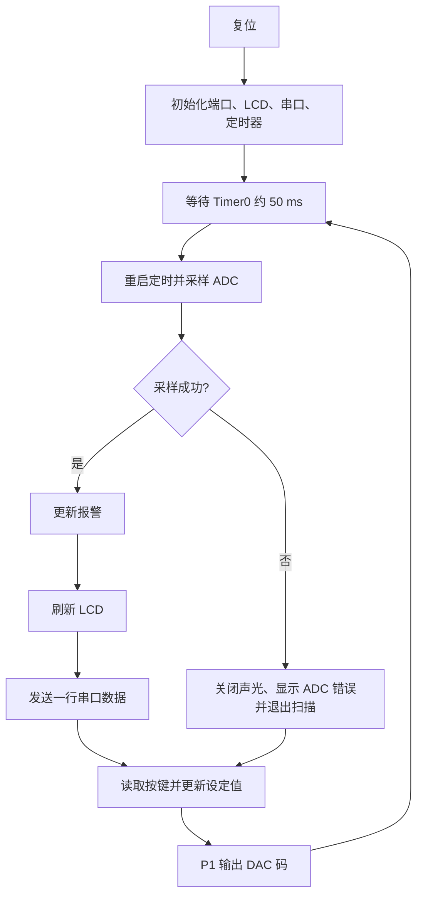
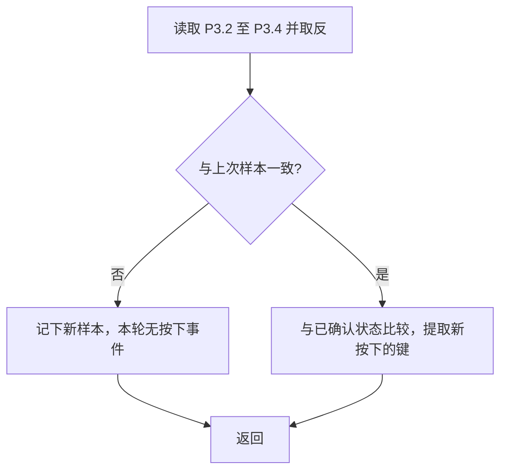
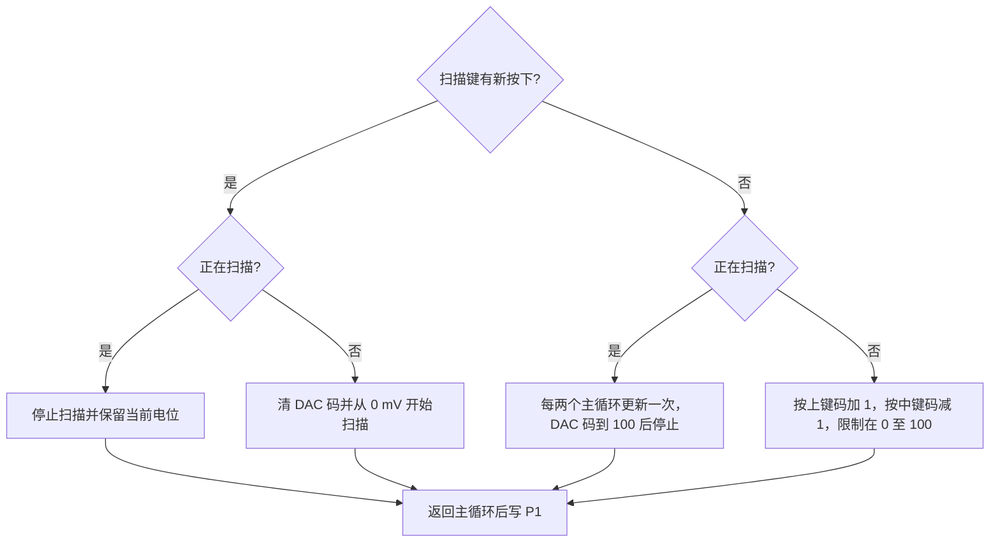
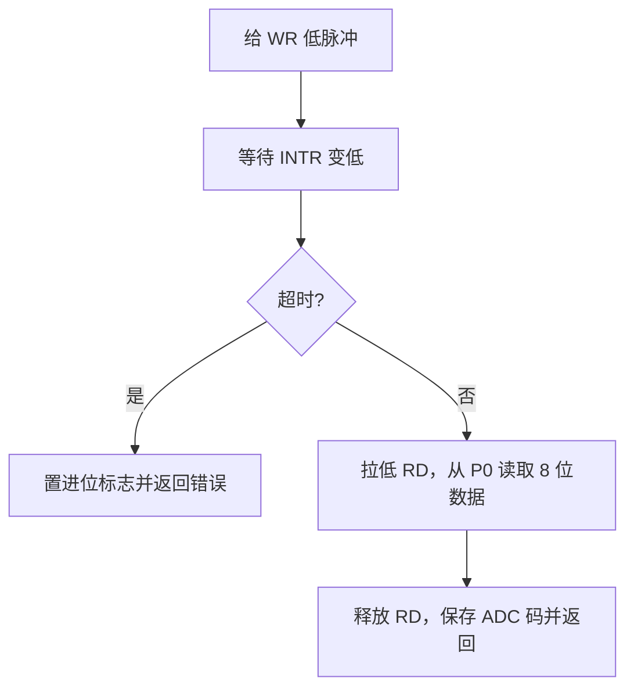
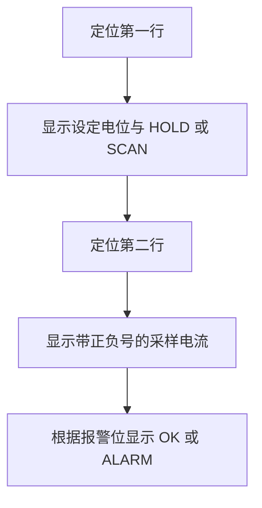
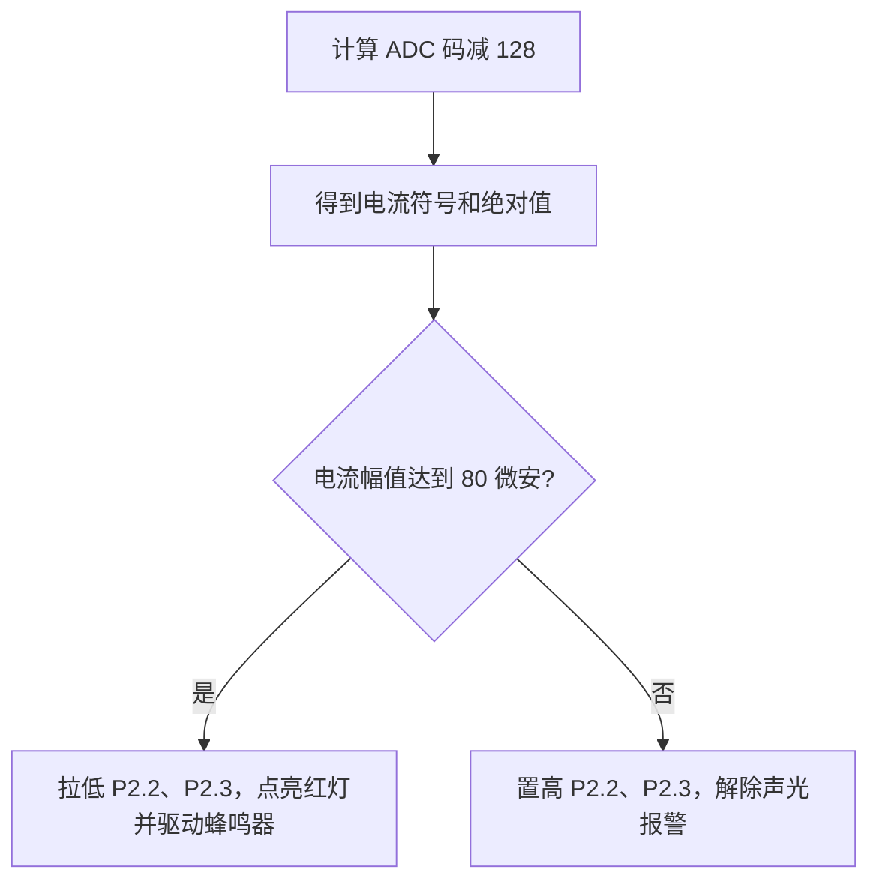
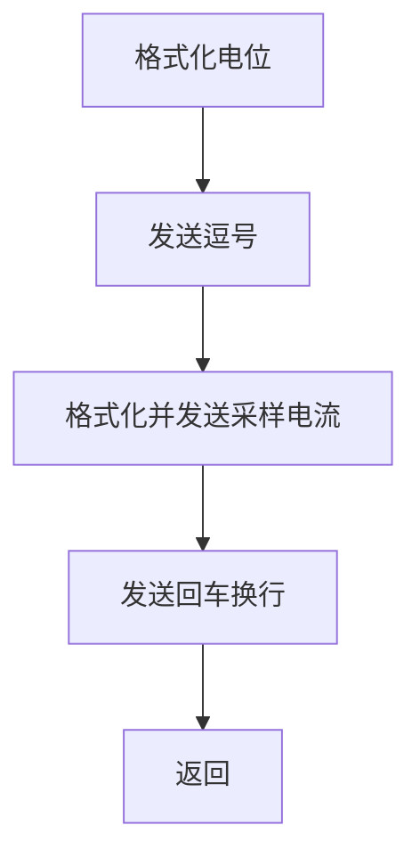

# 基于 AT89C51 的简易恒电位仪

## 工程运行与演示

1. 解压全部文件，用 Proteus 8.17 打开 `.pdsprj`。若提示固件路径无效，双击 U1，将 Program File 指向同目录的 `potentiostat.hex`。U1 时钟为 11.0592 MHz。
2. 保持右下角 R11 为 20 kΩ，启动仿真。从 0 mV 按上键 P12 十次，LCD 应显示 −100 mV HOLD，直流表 WE−RE 约 −0.10 V，电流约 −5 µA。中键 P13 每次往 0 调 10 mV。
3. 按下键 P14 开始扫描，观察 LCD 的 SCAN 和右上虚拟终端。扫描从 0 mV 到 −1000 mV，每步 10 mV，约每 100 ms 更新一步。再按下键可提前停止。
4. 测试报警时，停仿真，将 R11 临时改成 1 kΩ。重启后设 −100 mV，LCD 显示约 −100 µA 和 ALARM，红灯亮、蜂鸣器响。测完将 R11 恢复为 20 kΩ。
5. 虚拟终端设为 9600、8N1。每行两列依次为设定电位（mV）、测得电流（µA）。如需 PC 外部串口软件收数，在支持虚拟串口的环境中增加 COMPIM，用配对 COM 口做联机验收。当前已验证的是 Proteus 虚拟终端。

## 模块与位置

| 模块 | 原理图位置 | 功能 |
|---|---|---|
| 主控 | 左侧中间 U1 和晶振、复位电路 | AT89C51 执行 8051 汇编，调度采样、输出和交互 |
| 按键 | U1 下方 P12、P13、P14 | P3.2 往负方向调整，P3.3 往 0 调整，P3.4 启停扫描 |
| DAC | 中间偏右 U4、U2 和最右侧 U6:A | DAC0808 输出经 741 和 U6:A 转成 VTARGET |
| 三电极闭环 | 上方中部 U6:B，右下 R11、R12 | 比较 VTARGET 和 RE，经 CE 闭环调节。R11、R12 模拟电解池，直流表测 WE−RE |
| 微电流采样 | 上方偏右 U6:C、右下 R10、左下 U5 | WE 电流经 19.53 kΩ 跨阻反馈转换为 I_SENSE，ADC0804 数字化，约 1 µA/码 |
| 显示 | 左上 LCD2、RV1 | 显示设定电位、采样电流、HOLD/SCAN 和 OK/ALARM，RV1 调对比度 |
| 声光 | 上方 D1、BUZ1、Q1 | P2.2 和 P2.3 低电平有效，电流绝对值达到 80 µA 时报警 |
| 串口 | 上方黑色虚拟终端 | P3.1/TXD 发送电位、电流，支持整理为 CSV |

## 总流程图

## 各功能子程序流程图

### 按键消抖 · KEY_READ

### DAC 设定与线性扫描 · UPDATE_SETPOINT

### ADC 采样 · ADC_READ

### LCD 显示 · LCD_SHOW

### 电流换算与报警 · CURRENT_MAG / ALARM_UPDATE

### 串口输出 · UART_ROW

## 验证记录与曲线

- 恒电位模式已观察到设定 −100 mV、WE−RE 约 −0.10 V、20 kΩ 负载时约 −5 µA。
- 扫描时已观察到 LCD 显示 −220 mV、−11 µA；另有虚拟终端截图记录 0 至 −40 mV 的部分采样行。
- 1 kΩ 报警负载下已验证 LCD、LED 和蜂鸣器。
- 完整扫描来自 Proteus 虚拟终端，共 428 行，覆盖 0 至 −1000 mV 的全部 101 个设定点，含起终点保持时的重复读数。Proteus串口原始记录.txt 保留完整数据行。完整扫描仿真采样.csv 按设定电位计算平均电流，E 为 mV，I 为 µA，N 为记录数。曲线叠加了 20 kΩ 理论响应。外部 PC 串口接收尚待验证。
- LCD 与串口的电位字段是设定值。实测 WE−RE 由原理图直流表读取。当前曲线描述的是电阻等效负载。

